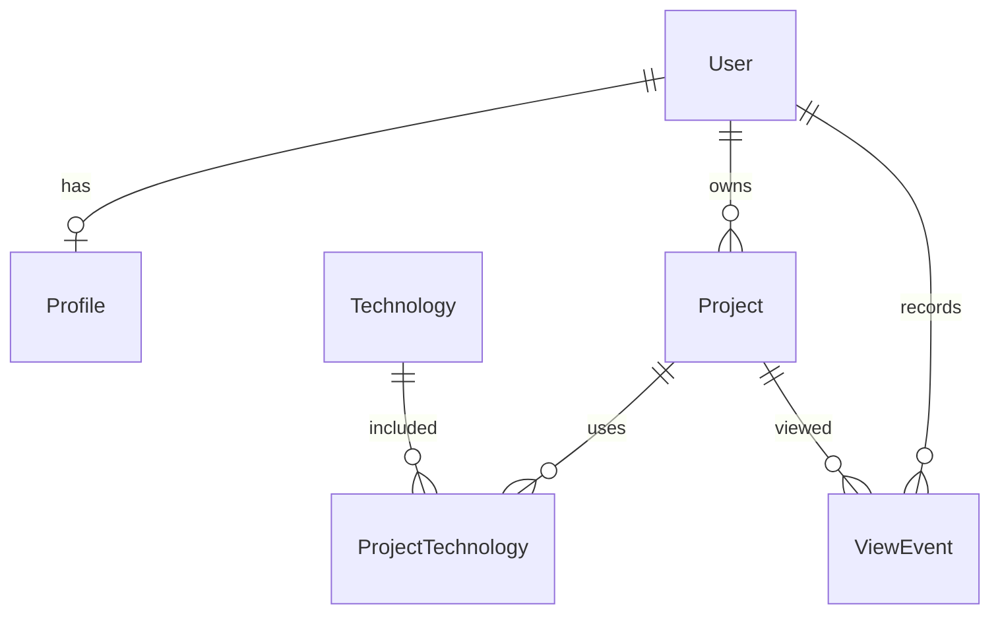
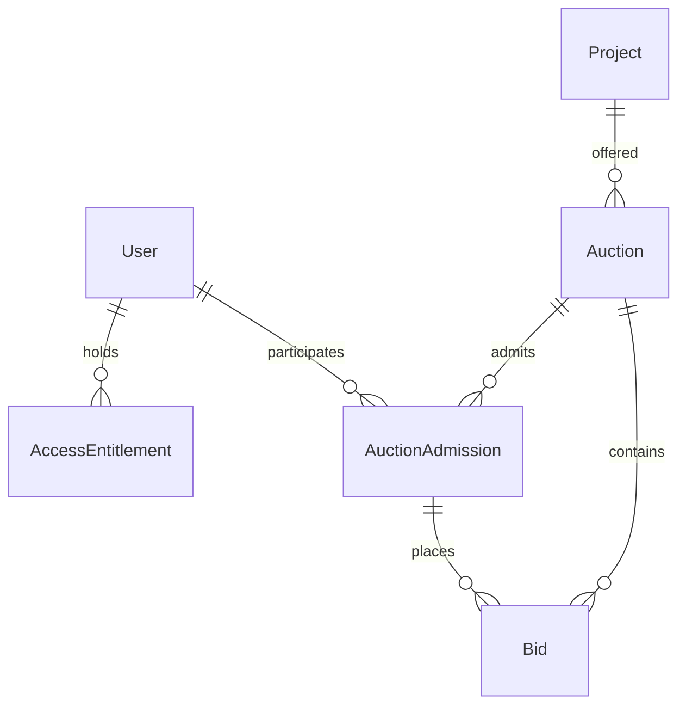

# Data Model v0 — SCRUM-20

**Статус: предложение для review команды.** Это логическая модель и словарь данных, а не реализованная схема PostgreSQL. Ни JPA entities, ни доменные миграции, ни продуктовые сервисы этим документом не создаются.

Источники: задачи [SCRUM-20](https://andrewalexxeev.atlassian.net/browse/SCRUM-20), [SCRUM-21](https://andrewalexxeev.atlassian.net/browse/SCRUM-21), SCRUM-1/7/24–29; требования «Micrup_Stage_1 (1)(1).pdf», разделы 1 и 6. PDF содержит предварительные продуктовые правила, которые не подменяют согласование команды.

## Границы этапов

| Этап | Сущности и результат |
| --- | --- |
| Sprint 0 | Описать все минимальные сущности и API mapping. Согласовать технические решения и выделить продуктовые вопросы. |
| Sprint 1 — SCRUM-24 | Реализовать минимальные Project/Technology/ProjectTechnology и связь с владельцем, необходимые для чтения каталога; тестовые данные и новая миграция — в этой задаче. Способ представления владельца согласовать до миграции, не реализуя authentication. |
| Следующие этапы MVP | User/Profile, размещение/модерация, ViewEvent/рекомендации, подписочный доступ, Auction/Bid/допуск и тестовые операции услуг площадки. Они не объявляются Post-MVP только потому, что не входят в Sprint 1. |
| Post-MVP | Веб-клиент, чат, сложный ML, брокерская комиссия/сопровождение, приём цены проекта, эскроу внутри площадки, автоматическая подпись документов, компенсация за недоступного участника. |

Существующая V1__init.sql содержит только app_metadata. Она остаётся неизменной. Доменные таблицы добавляются следующей миграцией в задаче реализации.

## Общие технические предложения v0

- Domain ID: UUID; JSON — string/uuid, PostgreSQL — uuid. ID технической app_metadata не задаёт тип доменных ключей.
- Моменты времени: UTC instant; PostgreSQL timestamptz; JSON RFC 3339 date-time. Отдельные календарные даты — date.
- Деньги: Money { amountMinor: int64, currency: RUB }; amountMinor — копейки, не float и не рубли. Максимум v0 — 9 000 000 000 000 000 копеек, безопасный целый JSON; это техническая граница, а не ценовой сегмент привлечения.
- Цена объявления > 0; неизвестное значение показателя не заменяется нулём. Приоритетный сегмент 100 тыс.–3 млн ₽ не является ограничением размещения.
- UI и JSON используют camelCase; SQL в будущем — snake_case. Один и тот же смысл не получает разные единицы на Android/backend.
- Часы поддержки — число часов **в неделю**, supportHoursPerWeek, не общее число часов.
- Логическая модель и transport DTO различаются: DTO не выдаёт контакты, документы и служебные поля просто потому, что они есть у сущности.

Эти решения подлежат review обеих сторон до фиксации контракта.

## Основные связи

Профиль может отсутствовать до заполнения; владелец Project обязателен. В событии просмотра userId обязателен в контракте v0: анонимная история/рекомендации отложены до отдельного решения. Бесплатный просмотр каталога при этом возможен без аккаунта.

| Сущность | Основные поля | Ключи/ограничения |
| --- | --- | --- |
| User | id, createdAt, updatedAt; auth identity определяется задачей authentication | PK id; уникальная auth identity после выбора провайдера; покупатель/продавец — действия одного пользователя, не взаимоисключающие типы аккаунтов |
| Profile | userId, displayName, bio?, createdAt, updatedAt | PK/FK userId → User; один профиль; контакты хранятся отдельно от публичного DTO |
| ProfileContact | id, userId, kind, value, disclosureConsent, updatedAt | FK userId → User; закрытое значение; серверная проверка consent и права доступа до выдачи |
| Project | id, ownerId, title, type, askingPrice, shortDescription, description, supportHoursPerWeek, saleReason?, transferredAssets[], publicationStatus, rejectionReason?, createdAt, updatedAt, publishedAt? | PK id; FK ownerId → User; допустимость пустых полей зависит от draft/published |
| Technology | id, name, slug | PK id; UNIQUE slug; названия нормализуются командой |
| ProjectTechnology | projectId, technologyId | Составной PK; FK → Project/Technology; повтор технологии запрещён |
| ProjectMetrics | projectId, periodStart, periodEnd, revenue?, expenses?, payingUserCount?, publicDisclosureConsent | FK → Project; согласованный период, одна валюта; значения не считаются проверенными без отдельного подтверждения |
| ViewEvent | id, userId, projectId, occurredAt | PK/FK; v0 — authenticated history; event ID уникален на пользователя для повторов |

Показатели представляют суммы **за указанный период**, а не молча «в месяц». Для сопоставления/фильтрации по месячному доходу сначала согласуется нормализация периода. Неизвестные показатели не удовлетворяют числовому фильтру.

### Проект и публикация

Предлагаемые type: BOT, WEB_SERVICE, MOBILE_APP, OTHER. Расширение enum требует обновления Android/backend.

publicationStatus: DRAFT → PENDING_REVIEW → PUBLISHED либо REJECTED; исправленный REJECTED возвращается в DRAFT; PUBLISHED может стать ARCHIVED. Кто и как меняет опубликованный проект, как архивирует/повторно публикует — отдельные правила размещения, не реализация Sprint 0.

- В draft поля могут отсутствовать.
- Для отправки на модерацию обязательны title, type, askingPrice, shortDescription, description, технологии и supportHoursPerWeek. Утверждение дополнительных обязательных показателей — вопрос команды.
- Публичные GET возвращают только PUBLISHED. Неизвестный, чужой черновик и архивный проект получают одинаковую 404 без раскрытия существования.
- Контакты и закрытые доказательства показателей не входят в ProjectSummary/ProjectDetails.
- Публичное metrics по умолчанию null. Если команда разрешит раскрытие определённых summary-показателей с согласием продавца, сервер выдаёт только разрешённую проекцию; подробные документы остаются закрыты.

## Доступ и аукцион — следующие этапы MVP

| Сущность | Поля/связи | Что фиксируется сейчас |
| --- | --- | --- |
| AccessEntitlement | id, userId, kind, startsAt, expiresAt, status | FK User; kind CONTACT_SUBSCRIPTION как предварительный вариант, не доступ на каждый проект. Срок подписки и точные права согласуются в SCRUM-7. |
| Auction | id, projectId, sellerId, startPrice, bidStep, startsAt, endsAt, status | FK Project/User; суммы в Money, step > 0, endsAt > startsAt; допустимое число/состояния аукционов на проект требуют решения |
| AuctionAdmission | id, auctionId, userId, fixedFee, status, paymentOperationId? | UNIQUE (auctionId,userId); отдельный платный допуск, подписка его не заменяет |
| Bid | id, auctionId, admissionId, bidderId, amount, acceptedAt, sequence | FK Auction/Admission/User; согласованность участника и аукциона; bid amount/срок проверяются сервером атомарно |
| PaymentOperation | id, userId, purpose, auctionId?, providerEventId?, amount, status, reversalOf? | Только услуги Micrup в sandbox, уникальность provider event и связь возврата с исходной операцией; никаких расчётов за сам проект |

В PDF предложены тарифы входа/возврата и выдача продавцу последней ставки **каждого** участника, а не автоматический выбор единственного покупателя. Эти формулы предварительные: SCRUM-7 должна подтвердить параметры, округление, отмену, возврат на исходный способ оплаты и повторные уведомления. Они не кодируются в Sprint 0.

Дополнительные сущности будущего MVP: AssetEvidence (закрытые подтверждения), SavedFilter, AuctionAdmission, PaymentOperation. Они не заменяются одной таблицей Bid или свободным JSON «на все случаи». Их физическая схема и API не входят в минимальный SCRUM-21.

## Согласование с API

| Модель | DTO/операция |
| --- | --- |
| Project + Technology | ProjectSummary, ProjectPage; GET /api/v1/projects |
| Project + профиль владельца + разрешённые показатели | ProjectDetails; GET /api/v1/projects/{projectId} |
| Profile | UserProfile для владельца, SellerProfile для публичного просмотра |
| Project draft | ProjectDraft, ProjectDraftInput; создание/замена своего draft и submit |
| ViewEvent | ViewEventInput { eventId }; проект из URL, userId из auth, occurredAt назначает сервер |
| Ошибка валидации/доступа | ApiError { code, message, fieldErrors, traceId } |

DTO и примеры задаются в SCRUM-21. Поля ownerId, userId, publicationStatus и timestamps в write requests не передаются клиентом как доверенные значения.

## Решения, требующие согласования

| Вопрос | Предложение/граница | Зависимость |
| --- | --- | --- |
| UUID, Money, timestamps, enum | Технический baseline выше | SCRUM-20/21, review Android/backend |
| Публичные финансовые показатели | Закрыто по умолчанию; только согласованная проекция с consent | SCRUM-1/7 |
| Обязательные данные до публикации | Минимум выше; неполный draft допустим | SCRUM-1 и размещение |
| Authentication | Принцип authenticated user, провайдер/токены ещё не выбраны | SCRUM-2/4 и auth epic |
| Анонимные просмотры | Запись ViewEvent только для аккаунта в v0 | Продукт/рекомендации |
| Область/срок подписки, аукцион/возвраты | Предварительные правила PDF не становятся автоматическим решением | SCRUM-7 |

До подтверждения этих решений документ остаётся предложением. Наличие ER-схемы само по себе не подтверждает согласование и Done.
